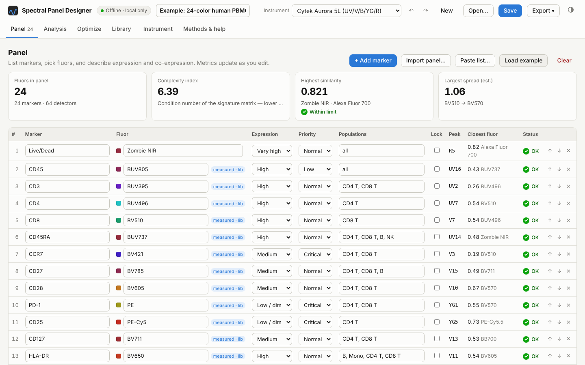
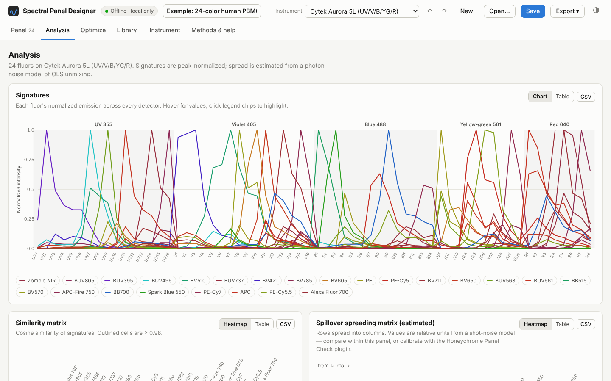
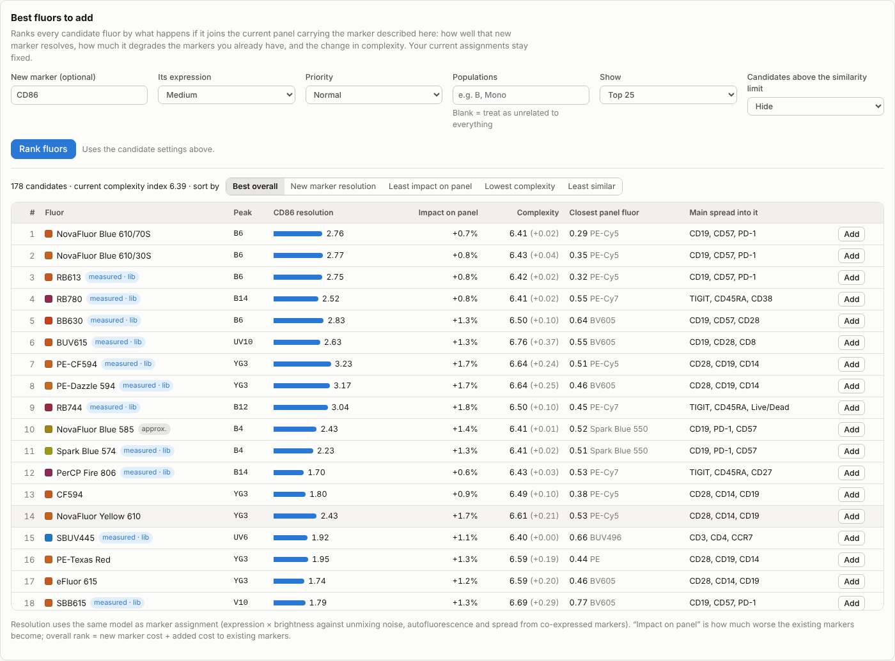

# Panelyzer

[](https://doi.org/10.5281/zenodo.23540198)

**An offline, single-file tool for designing spectral flow cytometry panels.**
Pick an instrument, list your markers, and see signature similarity, complexity index and
predicted spillover spreading update as you edit. Let the optimizers pick a low-complexity fluor
set, place markers on fluors, or rank the fluors that would fit best as your next marker.
Everything runs in your browser from one HTML file: no account, no server, no network requests.

[**Open the app**](https://colejbatty.github.io/panelyzer/) ·
[Download the HTML](https://github.com/colejbatty/panelyzer/releases/latest) ·
[Methods](docs/METHODS.md) · [Validation](docs/VALIDATION.md) · [Honeychrome integration](docs/HONEYCHROME.md) ·
[How it was made](#how-panelyzer-was-made)

> **Status: beta (v0.9).** The math is tested against NumPy and the simulated spectra are validated
> against measured reference libraries (below), but predictions are planning estimates. Always
> confirm a panel with single-stain controls on your own instrument.



## Features

- **Instruments**: Cytek Aurora 5L (64 detectors) and Sony ID7000 (5- and 7-laser), plus custom
  instruments defined in JSON (any laser/detector layout).
- **Spectra**: 271 FPbase excitation/emission spectra, approximations for common dyes FPbase lacks,
  and Honeychrome's *measured* reference libraries for the Aurora (93 fluors) and ID7000 (65 fluors),
  which are used ahead of simulation. About 330 fluors in total.
- **Your own references**: import single-stain FCS files (signature extraction with an optional
  unstained control), reference CSVs exported from instrument software, custom dye spectra and
  autofluorescence profiles. Measured references calibrate per-detector gains for every simulated dye.
- **Panel metrics**: per-fluor signatures, cosine similarity matrix, complexity index (condition
  number), noise amplification and an estimated spillover-spreading matrix from a photon-noise model
  of OLS unmixing, with and without autofluorescence.
- **Optimizers**
  - *Suggest fluors*: greedy + swap search for a fluor set that minimizes complexity or total noise,
    under a similarity limit, from the whole library or only what is in stock.
  - *Optimize assignment*: simulated annealing that places markers on fluors using expression,
    brightness, priority and co-expression (populations), respecting locks.
  - *Best fluors to add*: ranks every candidate by how well a new marker would resolve on it and how
    much it would hurt the markers already in the panel.
- **Import** Cytek-style panel CSVs (vendor names such as "cFluor B520", "NovaFluor Blue 610-30S"
  and "Brilliant Violet 605" resolve automatically), pasted lists, and Honeychrome experiments.
- **Save/open** panels as `.panelyzer.json`; export CSVs (signatures, matrices, single-stain control
  checklist) and a printable report.

| Analysis | Best fluors to add |
|---|---|
|  |  |

## Quick start

1. Download `Panelyzer.html` from the [latest release](https://github.com/colejbatty/panelyzer/releases/latest)
   (or use the [hosted copy](https://colejbatty.github.io/panelyzer/), which is the same file).
2. Open it in a current Chrome, Edge, Firefox or Safari. It works from a local file with no internet.
3. Click **Load example**, or **Import panel…** to bring in a Cytek panel CSV.

## How accurate is it?

Simulated signatures are compared with Honeychrome's measured reference spectra for every dye present
in both (`npm run validate`). Calibration is leave-one-out: each dye is predicted with detector gains
fitted on the others, which is how the app calibrates by default.

| Instrument | Dyes compared | Cosine, raw: mean (median) | Cosine, calibrated: mean (median) | ≥ 0.95 after calibration |
|---|---|---|---|---|
| Cytek Aurora 5L | 48 | 0.935 (0.945) | 0.961 (0.977) | 35/48 |
| Sony ID7000 | 41 | 0.830 (0.879) | 0.920 (0.960) | 23/41 |

For fluors in the measured libraries, the app uses the measured spectrum instead, so these numbers
only matter for dyes the libraries lack. The math (complexity index, unmixing matrix, spreading
matrix) is tested against NumPy to 1e-8 or better. See [docs/VALIDATION.md](docs/VALIDATION.md) for details and the
worst cases.

### Limitations

- Spread values are **relative** (shot-noise model, unit photon yield). Calibrate them with the
  Honeychrome Panel Check plugin to get instrument units.
- Simulation ignores filter roll-off, beam geometry, detector voltages and dye lot variation.
  Cross-laser ratios are the least reliable part, especially on the ID7000, whose channel boundaries
  are not published (they were fitted to the measured library).
- Brightness ratings are generic 1–5 estimates; edit them for your reagents.
- Tandem degradation and dye–dye interactions are not modelled.

## Honeychrome integration

[Honeychrome](https://github.com/Cytkit/honeychrome) is an open-source spectral cytometry analysis
application. The two tools work together in both directions:

- **Import Honeychrome…** (Library tab) reads a Honeychrome experiment (`.kit`): its cleaned reference
  spectra, AutoSpectral autofluorescence profiles and label/antigen pairs. Each reference is checked
  against the measured library to flag suspect controls.
- The **Panel Check** plugin ([`plugin/panel_check_tab.py`](plugin/panel_check_tab.py)) adds a tab
  to Honeychrome. It reports complexity, similarity and predicted spread for the experiment's
  spectral model, checks every control against the library, measures the spillover-spreading matrix,
  stain indices and unmixing residuals from the single-stain controls, and exports a JSON file. When
  the designer imports that file, it scales its spread predictions to your instrument.

See [docs/HONEYCHROME.md](docs/HONEYCHROME.md) for installation and details.

## Privacy

The app makes no network requests (a Content-Security-Policy blocks them) and stores nothing in the
browser. Panels, FCS files and references stay on your computer unless you save them somewhere.

## Development

```sh
npm ci
npm run build        # -> dist/Panelyzer.html
npm test             # unit tests (node:test)
npm run test:e2e     # Playwright end-to-end tests (run `npx playwright install chromium` once)
npm run validate     # simulated vs measured spectra table
python -m pytest plugin/tests   # Panel Check plugin (numpy + pytest)
```

The source is plain JavaScript with no runtime dependencies:

| Path | Contents |
|---|---|
| `src/engine.js` | Linear algebra, signature simulation, unmixing/spread, optimizers, file parsers |
| `src/data_lib.js` | Instrument presets, fluor metadata, derived (approximate) dyes |
| `src/app_core.js`, `src/app_views.js`, `src/charts.js` | State, UI and SVG charts |
| `data/` | Encoded FPbase spectra and Honeychrome measured libraries |
| `tools/` | Scripts that regenerate the data and validation numbers |
| `plugin/` | Honeychrome Panel Check plugin and its tests |

See [CONTRIBUTING.md](CONTRIBUTING.md) to add a dye, an instrument or a feature.

## How Panelyzer was made

Panelyzer was developed with substantial help from **Claude** (Anthropic), a generative AI model,
used through Claude's Cowork mode in October 2026.

- **Cole Batty** set the goals, requirements and design decisions; supplied real panels and
  Honeychrome experiments for testing; reported problems; and decided what to change. He is
  responsible for the project and its releases.
- **Claude** wrote most of the code, tests and documentation, and ran the validation scripts.
  Commits made with AI assistance carry a `Co-Authored-By: Claude` trailer.

Nothing in this repository depends on trusting that process: the math is checked against NumPy, and
every number in [docs/VALIDATION.md](docs/VALIDATION.md) comes from scripts here that anyone can
rerun. If you find an error, please [open an issue](https://github.com/colejbatty/panelyzer/issues).

## License and data

- Code: **LGPL-3.0-or-later** © Cole Batty and contributors ([COPYING.LESSER](COPYING.LESSER), [COPYING](COPYING)).
- FPbase spectra (`data/fpbase_spectra.txt`): **CC BY-SA 4.0**, from [FPbase](https://www.fpbase.org).
- Honeychrome measured reference libraries (`data/honeychrome_library.json`): **LGPL-3.0**, from
  [Honeychrome](https://github.com/Cytkit/honeychrome).

Details and attribution are in [DATA_LICENSES.md](DATA_LICENSES.md).

## Citing

If you use Panelyzer in published work, please cite the version you used. For v0.9.0:

> Batty, C. (2026). *Panelyzer: offline spectral flow cytometry panel design* (Version 0.9.0)
> [Computer software]. Zenodo. https://doi.org/10.5281/zenodo.23540199

To refer to the project as a whole (all versions), use https://doi.org/10.5281/zenodo.23540198.
GitHub's "Cite this repository" button gives the same information from [CITATION.cff](CITATION.cff).
Please also cite FPbase (Lambert, *Nat Methods* 2019, doi:10.1038/s41592-019-0352-8) for the spectra.
